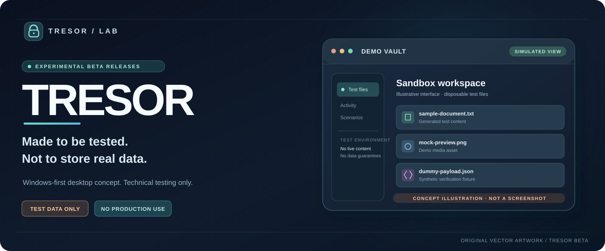
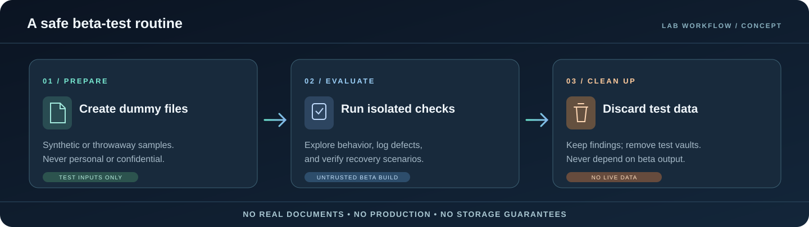

<div align="center">



<br />

# TRESOR / BETA LAB

**An experimental Windows desktop project for technical testing — not a product for real-world data storage.**

[](https://github.com/rootkid-code/tresor-releases/releases)


[**View beta releases**](https://github.com/rootkid-code/tresor-releases/releases) · [**Release information**](#release-status) · [**Testing guidelines**](#the-only-intended-use-testing) · [**Remaining work**](#what-is-not-finished)

</div>

---

> [!CAUTION]
> ### TEST VERSION ONLY — NOT FOR REAL DATA
>
> **Tresor is an unfinished, experimental beta project. It is not production-ready, independently security-certified, or approved for personal or professional data storage.**
>
> **Do not use it to store, encrypt for safekeeping, back up, transfer, or protect real files.** Never import documents, private photos, passwords, credentials, business data, financial records, or any file you cannot afford to lose.
>
> **Use exclusively synthetic, disposable test files in an isolated test environment.** Unexpected defects, data loss, corrupted test vaults, security weaknesses and incompatible updates are possible. No security, availability, recovery or compatibility guarantee is provided.
>
> **The existence of encryption features, installers, downloads or update feeds does not change this restriction.**

## Project at a glance

| | |
| :-- | :-- |
| **Project** | Tresor — Windows-first offline vault *prototype* |
| **Current purpose** | Explore implementation, evaluate technical behavior, discover defects |
| **Release channel** | **Experimental beta / test builds only** |
| **Last publicly published beta confirmed on 21 November 2026** | [`v0.1.1-beta.12`](https://github.com/rootkid-code/tresor-releases/releases/tag/v0.1.1-beta.12) |
| **`v0.1.1-beta.13`** | Prepared in the private development repository; **not confirmed as publicly released** |
| **Stable release** | **None** |
| **Real data storage** | **Not permitted / not recommended for this test project** |
| **Independent security assessment** | Not established |
| **Guarantees & production support** | None |

## The only intended use: testing

<div align="center">

</div>

**This repository exists to distribute experimental builds for controlled evaluation.** Appropriate activities include testing a feature with generated sample files, reproducing bugs, evaluating UI behavior, testing upgrades and failure cases, and collecting technical feedback.

**Not appropriate:** storing real data, relying on Tresor as a backup, securing sensitive information, using it in daily work, or claiming a beta build is a finished security product.

The graphics above are **original concept illustrations**, not application screenshots and not evidence that a feature has passed security validation.

## Prototype capabilities under evaluation

The development project explores a local-first Windows desktop application using **Tauri, Rust, React and TypeScript**, including:

| Area | What is being explored | Status |
| :-- | :-- | :-- |
| Vault fundamentals | Test vault creation, unlocking and encrypted file handling | Beta implementation; not production-certified |
| File workflows | Experimental import, preview, search and explicit export | Test-only |
| Transfer & recovery | Experimental encrypted share packages, backups and restore flows | Test-only; additional recovery validation required |
| Desktop controls | Session timeout, lock behavior and native host boundaries | Under continued review |
| Distribution | Windows installer packaging, release checks and update-feed artifacts | Experimental release infrastructure |

These are **technical development areas, not promises of reliability, security or fitness for actual storage**.

## Release status

<div align="center">

**EXPERIMENTAL BETA** → **MORE TESTING REQUIRED** → **STABLE RELEASE NOT AVAILABLE**

</div>

The latest version **confirmed as publicly published** in this distribution repository as of **21 November 2026** is **`v0.1.1-beta.12`**. The source project's `v0.1.1-beta.13` entry does not itself mean a public, tested release is available.

[Browse the published beta artifacts](https://github.com/rootkid-code/tresor-releases/releases)

A release tag, passing automated check, installer signature, checksum, GitHub draft or downloadable artifact **must never be interpreted as production approval**. Where a `SHA256SUMS.txt` file is supplied, a matching checksum checks file integrity against that manifest; it is **not proof of application security**.

### Release lifecycle

```text
Development → automated checks → beta packaging → review → optional beta publication
                                                     ≠ production approval
```

Release publication is a separate action from creating a draft or building test packages. Additional independent acceptance criteria would be required before any future stable release.

## What is not finished

The project requires substantial further work. The list below describes **open engineering and release-readiness requirements**, not completed certifications.

| Priority area | Before any production discussion |
| :-- | :-- |
| **Independent security review** | Review application trust boundaries, cryptographic integration, dependencies, filesystem access and session handling; remediate findings and retest |
| **Rollback resistance** | Implement and validate an external monotonic anchor; local vault integrity checks alone cannot reliably detect a complete rollback to a previously valid vault |
| **Data loss & recovery testing** | Stress-test interrupted writes, corrupted data, backups, restores, migrations, failed updates and recovery across versions |
| **Windows compatibility** | Verify supported Windows versions, WebView2 dependencies, permissions, accessibility, scaling, hardware and edge cases |
| **Release integrity** | Validate signing, update trust, reproducibility, installation, upgrades, failure handling and uninstall behavior |
| **Performance & UX** | Test resource consumption, previews, optional local image-processing paths and clear failure feedback |
| **Documentation & support** | Define supported environments, known limitations, security reporting, acceptance gates and realistic support expectations |

Even after these engineering tasks, a future stable release would require **explicit validation and a separate release decision**. No such approval is claimed here.

## Security boundaries

Tresor's design does **not** promise protection against a compromised operating system, privileged malware, hardware keyloggers, or every possible exposure through memory, operating-system paging or screen capture.

The application is **not** presented as a replacement for an established storage, backup or security solution.

## About these repositories

| Repository | Purpose |
| :-- | :-- |
| **[tresor-releases](https://github.com/rootkid-code/tresor-releases)** | Public distribution area for experimental beta artifacts and update-feed files |
| **[tresor](https://github.com/rootkid-code/tresor)** | Development source, technical documentation and implementation history; currently private and may require access |

**Want to inspect a beta?** Use a disposable Windows test environment and dummy files only. Do not promote the result into real-world use, even if a short trial seems successful.

---

<div align="center">

### DEVELOPMENT PROJECT · BETA TESTING ONLY

**Not a finished product. Not secure storage for real files. Not production-ready.**

*No guarantee of confidentiality, data integrity, recovery or continued compatibility.*

<sub>Original vector illustrations created specifically for this README. Illustrative only; no actual application screens are depicted.</sub>

</div>
