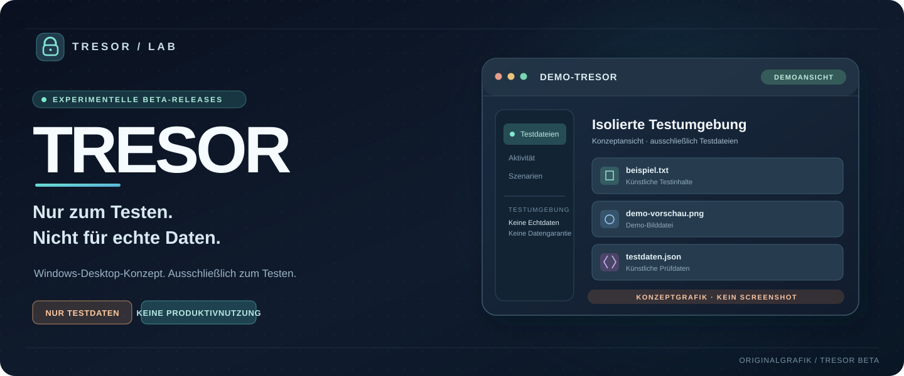
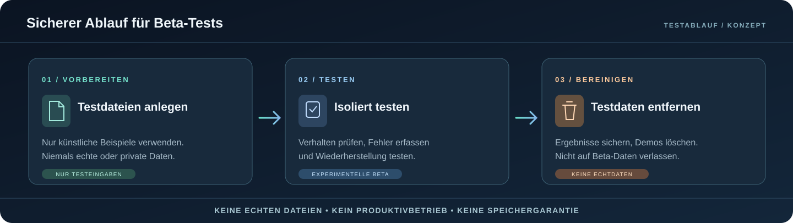

**Deutsch** · [**English**](docs/README.en.md)

# TRESOR / BETA LAB

**Experimentelles Windows-Desktopprojekt · Ausschließlich Testbetrieb · Keine Echtdaten**

[Veröffentlichungen](https://github.com/rootkid-code/tresor-releases/releases) · [Testregeln](#verbindliche-testregeln) · [Entwicklungsstand](#entwicklungsstand) · [Offene Arbeiten](#bis-zu-einer-möglichen-stabilen-version)

---

> [!CAUTION]
> ### AUSSCHLIESSLICH TESTVERSION – KEINE ECHTEN DATEN SPEICHERN
>
> **Tresor ist eine unfertige, experimentelle Beta-Version. Es handelt sich weder um eine produktionsreife Anwendung noch um eine zuverlässige Datensicherung oder eine unabhängig geprüfte Sicherheitslösung.**
>
> **Tresor darf nicht zur tatsächlichen Aufbewahrung, Absicherung, Verschlüsselung wichtiger Daten, Datensicherung oder Übertragung vertraulicher Dateien verwendet werden.** Keine echten Dokumente, privaten Fotos, Passwörter, Zugangsdaten, Geschäftsunterlagen, Finanzdaten oder sonstigen schützenswerten Inhalte importieren.
>
> Ausschließlich **künstlich erzeugte, jederzeit ersetzbare Testdateien in einer isolierten Testumgebung** verwenden. Fehler, Sicherheitslücken, beschädigte Testdateien, vollständiger Datenverlust und inkompatible Updates sind möglich. **Es gibt keine Garantie für Vertraulichkeit, Datenintegrität, Wiederherstellbarkeit, Verfügbarkeit oder Support.**
>
> **Verschlüsselungsfunktionen, Installationsdateien, Prüfsummen oder Update-Funktionen ändern nichts an dieser Einschränkung.**

## Über das Projekt

**Tresor** ist ein experimentelles, auf Windows ausgerichtetes Desktopprojekt. Es untersucht technisch, wie sich lokale Tresor-, Verschlüsselungs- und Dateiabläufe mit **Tauri, Rust, React und TypeScript** umsetzen lassen.

Dieses Repository dient ausschließlich der **öffentlichen Bereitstellung experimenteller Beta-Testpakete** und gegebenenfalls ihrer Update-Dateien. Es ist **keine Empfehlung zur Installation für den produktiven Einsatz**.

## Entwicklungsstand

| Bereich | Aktueller Stand |
| :-- | :-- |
| Produktstatus | **Experimentelle Beta / ausschließlich Tests** |
| Aufbewahrung echter Daten | **Nicht vorgesehen – ausdrücklich nicht verwenden** |
| Zielplattform | Windows Desktop |
| Zuletzt nachweislich öffentlich veröffentlichte Beta (geprüft am 21.11.2026) | [`v0.1.1-beta.12`](https://github.com/rootkid-code/tresor-releases/releases/tag/v0.1.1-beta.12) |
| `v0.1.1-beta.13` | In den Entwicklungsunterlagen vorbereitet; **keine bestätigte öffentliche Veröffentlichung** |
| Stabile / produktionsreife Version | **Nicht verfügbar** |
| Unabhängige Sicherheitsfreigabe | **Nicht nachgewiesen** |
| Garantien für Datensicherheit oder Wiederherstellung | **Keine** |

Eine Versionsangabe im privaten Quellrepository ist nicht mit einer tatsächlich veröffentlichten Testversion gleichzusetzen. Verfügbare Dateien stehen ausschließlich unter [GitHub Releases](https://github.com/rootkid-code/tresor-releases/releases).

## Verbindliche Testregeln

1. **Vorbereiten:** Ausschließlich künstliche und vollkommen unwichtige Beispieldateien erzeugen. Bei Bedarf einen separaten Testrechner oder eine isolierte Testumgebung nutzen.
2. **Testen:** Experimentelle Funktionen ausprobieren, Fehler dokumentieren und Ausfall- oder Wiederherstellungsszenarien ausschließlich mit Testmaterial prüfen.
3. **Bereinigen:** Test-Tresore und erzeugte Testdaten wieder entfernen. Nur Fehlerberichte und unkritische Testergebnisse aufbewahren.

**Ausgeschlossen sind:** echte private oder geschäftliche Dateien, tägliche Datenspeicherung, produktive Backups und jedes Vertrauen darauf, dass die Beta Daten zuverlässig schützt oder bewahrt.

> **Bildhinweis:** Die eingebundenen SVG-Grafiken sind eigens erstellte **Konzeptillustrationen**, keine tatsächlichen Screenshots und kein Nachweis geprüfter Funktionen.

## Technische Experimentierbereiche

| Bereich | Was im Projekt erprobt wird | Bewertung |
| :-- | :-- | :-- |
| Tresor-Grundlagen | Test-Tresore, Entsperrablauf und kryptografische Bausteine | **Experimentell** |
| Dateiabläufe | Import, Vorschau, Suche und bewusster Export | **Experimentell** |
| Austausch und Wiederherstellung | Verschlüsselte Testpakete, Backup- und Restore-Abläufe | **Weitere Tests erforderlich** |
| Desktop-Schutzmechanismen | Sitzungssperren und Grenzen zwischen Oberfläche und Host | **In Prüfung** |
| Distribution | Windows-Installationspakete und Beta-Update-Infrastruktur | **Nur Testdistribution** |

Diese Tabelle beschreibt **Entwicklungs- und Testgegenstände**. Sie bedeutet nicht, dass die Funktionen fehlerfrei, sicher oder für die Praxis geeignet sind.

## Bis zu einer möglichen stabilen Version

Vor einer denkbaren Produktionsfreigabe sind umfangreiche technische Arbeiten und nachvollziehbare Abnahmen nötig. **Keine der folgenden Kategorien gilt hiermit als abgeschlossen:**

- **Unabhängige Sicherheitsprüfung:** Analyse von Kryptografie-Integration, Schlüsselverarbeitung, Systemgrenzen, Dateisystemzugriff, Abhängigkeiten und Desktop-Angriffsflächen; anschließend Fehlerbehebung und erneute Prüfung.
- **Schutz gegen vollständige Rücksetzung:** Ein externer, monotoner Zustandsanker fehlt. Interne Integritätsprüfungen allein erkennen nicht zuverlässig das Zurücksetzen eines ganzen Tresors auf einen älteren, ehemals gültigen Zustand.
- **Fehler- und Wiederherstellungstests:** Stromausfälle, Schreibabbrüche, beschädigte Dateien, Migrationen, Backups, Wiederherstellungen und unterschiedliche Versionsstände systematisch prüfen.
- **Windows-Kompatibilität:** Tests auf realen Geräten, mit verschiedenen WebView2-Umgebungen sowie Verbesserungen bei Bedienbarkeit, Barrierefreiheit und Fehlermeldungen.
- **Release-Sicherheit:** Nachweisbare Builds, Signatur- und Updateprüfung, Installation, Upgrade, Rückabwicklung und Deinstallation testen.
- **Leistung und Benutzerführung:** Ressourcenverbrauch, Vorschauen, optionale Bildverarbeitung und verständliche Rückmeldungen bei Fehlern untersuchen.
- **Dokumentation und Betrieb:** Bekannte Einschränkungen, unterstützte Umgebungen, Meldung von Sicherheitsproblemen, Supportgrenzen und klare Freigabekriterien definieren.

**Es gibt keinen angekündigten Termin für eine stabile Veröffentlichung und keine Freigabe für den produktiven Einsatz.**

## Veröffentlichung ist keine Sicherheitsfreigabe

Beta-Testpakete können Prüfsummen, digitale Signaturen oder technische Release-Metadaten enthalten. Solche Mechanismen können bei der Überprüfung von Herkunft oder Unversehrtheit helfen, **ersetzen aber weder Sicherheitsprüfungen noch eine ausdrückliche Produktionsfreigabe**.

Ein Git-Tag, ein erfolgreich ausgeführter Test, ein herunterladbares Installationsprogramm oder ein GitHub-Release bedeuten **nicht**, dass Tresor echte Daten sicher aufbewahren kann.

[Veröffentlichte Beta-Testpakete ansehen](https://github.com/rootkid-code/tresor-releases/releases)

## Sicherheitsgrenzen

Das Projekt macht keine Zusage zum Schutz gegen kompromittierte Betriebssysteme, Malware mit erhöhten Rechten, Keylogger oder sämtliche Formen der Offenlegung über Arbeitsspeicher, Auslagerungsdateien und Bildschirmaufnahmen.

**Unabhängig davon bleibt jede aktuelle Beta-Version für echte Datenspeicherung und Datensicherung ungeeignet.**

[**Dokumentations- und Release-Leitfaden**](docs/PROJECT_OVERVIEW.md)

## Projekt-Repositories

| Repository | Zweck |
| :-- | :-- |
| [**tresor-releases**](https://github.com/rootkid-code/tresor-releases) | Öffentliches Repository für experimentelle Beta-Testpakete und Update-Dateien |
| [**tresor**](https://github.com/rootkid-code/tresor) | Privates Entwicklungsrepository mit Quellcode und technischer Dokumentation; gegebenenfalls nur mit Berechtigung erreichbar |

---

### TRESOR IST EIN ENTWICKLUNGS- UND TESTPROJEKT

**NUR TESTDATEIEN · KEINE ECHTEN DATEN · KEINE PRODUKTIONSVERSION**

Alle Illustrationen wurden eigens für diese Dokumentation erstellt. Sie zeigen Konzepte und keine tatsächlich nachgewiesenen Produktansichten.

**Deutsch** · [**English**](docs/README.en.md)

