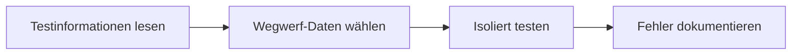

# TRESOR · BETA LAB — Release-Kommunikation

> Dokumentationsstand 21.11.2026. Keine neuen Tests, Produktionsfreigaben oder rechtlichen Abnahmen ausgeführt.

## Marken- und Kommunikationsziel

**Testversionen klar von sicheren Produkten trennen.** Ein öffentlicher Distribution-Kanal für experimentelle Tresor-Betas muss technische Transparenz und Gefahrenhinweise über Marketing stellen. Potenzielle Tester müssen in Sekunden erkennen, dass keinerlei echte Daten hier hingehören.

## Nutzerführung

*Das Diagramm ist ein Kommunikationsmodell und kein Nachweis produktiver Funktionen.*

## Verifizierte Originalmedien

| Datei | Einsatz |
|---|---|
| [`assets/tresor-beta-hero.de.svg`](../assets/tresor-beta-hero.de.svg) | Vorhandenes Original-Asset – Gestaltung, Version und Rechte prüfen |
| [`assets/tresor-beta-hero.svg`](../assets/tresor-beta-hero.svg) | Vorhandenes Original-Asset – Gestaltung, Version und Rechte prüfen |
| [`assets/tresor-test-workflow.de.svg`](../assets/tresor-test-workflow.de.svg) | Vorhandenes Original-Asset – Gestaltung, Version und Rechte prüfen |
| [`assets/tresor-test-workflow.svg`](../assets/tresor-test-workflow.svg) | Vorhandenes Original-Asset – Gestaltung, Version und Rechte prüfen |

**Visueller Standard:** Titelgrafik und Marke nicht ohne Kontrastabstand überlagern. In der README eine ausgewogene Bildhierarchie verwenden (Hero → Markensignet → max. 2–3 sinnvolle Produktbelege), nicht eine Galerie aller Favicons. PNG/JPG nur mit guter Kompression, Originalbild nicht als technische Funktion oder Live-Screenshot vortäuschen.

## Qualitätsgrenzen

**Experimentelle Beta**: Kein Produktivspeicher, keine echte Verschlüsselungs- oder Backup-Garantie. Veröffentlichte Release-Tags nur anhand tatsächlicher öffentlicher GitHub-Releases angeben; keine angekündigte Quellversion als bereits veröffentlicht ausweisen.

| Prüfung | Erwarteter Beleg | Dokumentationsstand |
|---|---|---|
| Asset-Pfade | GitHub-Datei lässt sich öffnen | Quellen inventarisiert |
| Licht/Dunkel | Logo bleibt kontrastreich | visuelle Prüfung offen |
| Text & A11y | klare Überschriften, Alt-Texte, Links | Review offen |
| Daten & Lizenzen | keine echten sensiblen Dateien/fehlenden Freigaben | Rechtliche Prüfung offen |
| Build/Release | aktuelle Tests mit Commit/Tag | nicht neu ausgeführt |
| Sicherheit | keine unbelegten Sicherheitsclaims | als Grenze dokumentiert |

## Redaktionsprinzip

Vor jeder Veröffentlichung Product Copy, Screenshots und Statusangaben am tatsächlichen Quellstand verifizieren. Icons von fremden Produkten sind keine Eigenmarke. Wenn sich die Produktidentität ändert, Logoquelle, Favicon, OG-Motiv, README und Social-Metadaten **gemeinsam** aktualisieren. Ohne geführte QA keine grünen „Production“-Badges.

## Nächster Review

1. Öffentliche Testanleitung vor Download priorisieren.
2. Checksum und Paketidentität mit den tatsächlichen Assets verifizieren.
3. Bugreport-Template für OS, Version, Repro-Schritte und Testdaten ergänzen.

[README](../README.md) · [Projektübersicht](PROJECT_OVERVIEW.md)
