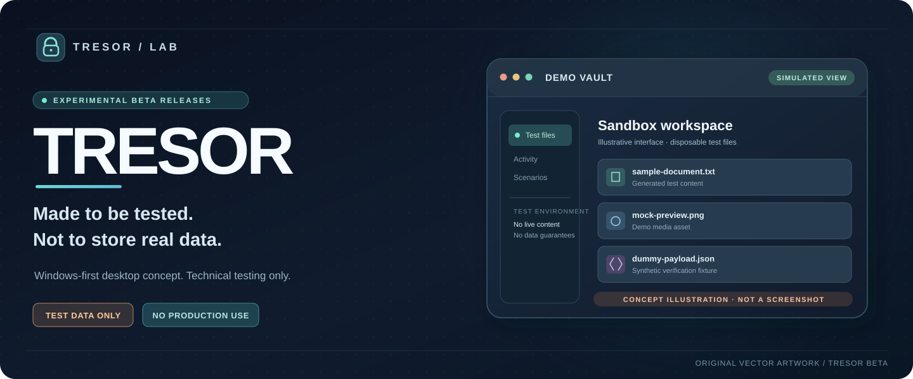
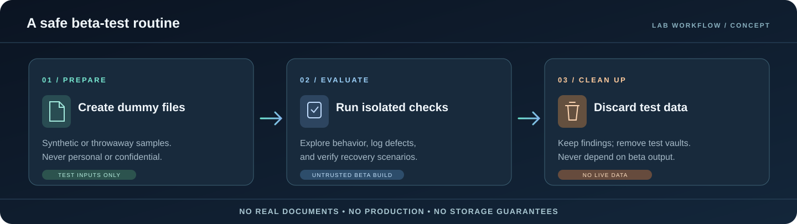

[**Deutsch**](../README.md) · **English**

# TRESOR / BETA LAB

**Experimental Windows desktop software · Test environment only · No real data**

[Releases](https://github.com/rootkid-code/tresor-releases/releases) · [Test rules](#test-rules) · [Development status](#development-status) · [Open work](#before-a-stable-release)

---

> [!CAUTION]
> ### STRICTLY FOR TESTING — DO NOT STORE REAL DATA
>
> **Tresor is an unfinished experimental beta, not a production product, secure-storage service, reliable backup system, or certified security tool.**
>
> **Never store, encrypt for real-world safekeeping, back up, share, or protect actual data with Tresor.** Do not import real documents, personal photos, credentials, financial information, business information, or confidential material.
>
> Only use **synthetic, disposable test files in an isolated test environment**. Beta builds may contain security weaknesses, corrupt files, lose data, or break compatibility. **No guarantee of confidentiality, integrity, recoverability, availability, or support is provided.**
>
> **The presence of cryptography, installers, signed artifacts, checksum files, or an update mechanism does not make these builds safe for real-world use.**

## About the project

Tresor is a **Windows-first desktop research and prototyping project** exploring offline file-vault functionality. The development project uses Tauri, Rust, React, and TypeScript.

This repository is the **public beta-distribution repository**. It holds experimental builds and update-feed files where applicable; it is not an endorsement for production deployment.

## Development status

| Category | Status |
| :-- | :-- |
| Product maturity | **Experimental beta / evaluation only** |
| Real data storage | **Not intended; do not use** |
| Platform focus | Windows desktop |
| Most recent confirmed public beta (checked 21 November 2026) | [`v0.1.1-beta.12`](https://github.com/rootkid-code/tresor-releases/releases/tag/v0.1.1-beta.12) |
| `v0.1.1-beta.13` | Listed in private-source development notes; **not confirmed as a public release** |
| Stable / production version | **Not available** |
| Independent security approval | **Not established** |
| Data protection, backup, or recovery guarantees | **None** |

The version shown in a source changelog may differ from the latest published public artifact. Check the [releases page](https://github.com/rootkid-code/tresor-releases/releases) for actual availability.

## Test rules

1. **Prepare:** Generate fake, non-sensitive, disposable sample files. Use a separate test machine or isolated test environment where appropriate.
2. **Evaluate:** Exercise experimental features, document defects, and test failure/recovery scenarios using dummy files.
3. **Clean up:** Discard disposable vaults and test outputs. Retain only bug reports and non-sensitive findings.

**Never:** import an actual personal or business file, use Tresor as a backup, treat it as everyday encrypted storage, or rely on its output.

> The graphics in this repository are **custom vector concept illustrations, not real app screenshots or evidence of tested product capabilities**.

## Prototype areas under evaluation

| Area | Development focus | Readiness |
| :-- | :-- | :-- |
| Vault foundation | Test-vault creation, unlock flow, encryption primitives | **Experimental** |
| File handling | Import, preview, indexing/search, deliberate export | **Experimental** |
| Recovery | Test backups, restore workflows, encrypted share packages | **Additional testing required** |
| Desktop controls | Session locking and native-host boundaries | **Under review** |
| Packaging | Windows installer builds and beta update artifacts | **Test distribution only** |

This is a description of the project's experimental scope, **not a claim that these features are secure or production-tested**.

## Before a stable release

A meaningful stable release would require further work and formal acceptance criteria. The following items are **not considered closed**:

- **Security:** Independent assessment and remediation of cryptographic integration, application boundaries, key handling, local filesystem attacks, dependencies, and desktop surface.
- **Rollback detection:** External monotonic state protection is not yet implemented; internal consistency checks do not prevent reverting a whole vault to an earlier valid state.
- **Resilience:** Broader power-failure, interrupted-write, corruption, migration, backup/restore, and compatibility testing.
- **Windows support:** Real-device tests, WebView2 environments, usability, accessibility, and failure-state handling.
- **Release chain:** Reproducibility evidence, signing verification, updater trust, installation/upgrade/uninstall and rollback tests.
- **Operational readiness:** Documented known issues, supported environment, security reporting, support boundaries, and a separately approved release process.

**There is no announced production-readiness date and no stable release available.**

## Release integrity is not product safety

Beta artifacts may come with checksums, signing, and release metadata. These can assist with validating artifact integrity or provenance, but **cannot substitute for independent testing, an audit, or production approval**. Public releases and GitHub drafts are different; a source tag does not automatically mean a public download exists.

[View published test releases](https://github.com/rootkid-code/tresor-releases/releases)

## Scope and limitations

Tresor does not claim protection against a compromised operating system, privileged malware, keyloggers, or all possible exposure via memory, paging, or screen capture. Its beta status alone also makes it **unsuitable for any real-world storage or recovery dependency**.

## Project links

- [**Public beta distribution**](https://github.com/rootkid-code/tresor-releases)
- [**Published beta releases**](https://github.com/rootkid-code/tresor-releases/releases)
- [**Development repository**](https://github.com/rootkid-code/tresor) — private; access may be required

---

**TRESOR IS A DEVELOPMENT EXPERIMENT.**

**TEST FILES ONLY · NOT FOR REAL DATA · NOT PRODUCTION-READY**

All illustrations are original diagrams and mockups for documentation, not screenshots or evidence of release readiness.

[Deutsch](../README.md) · **English**

